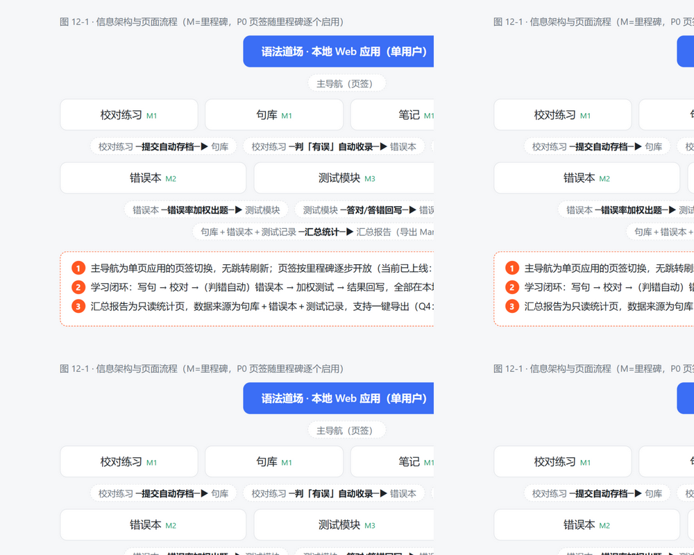
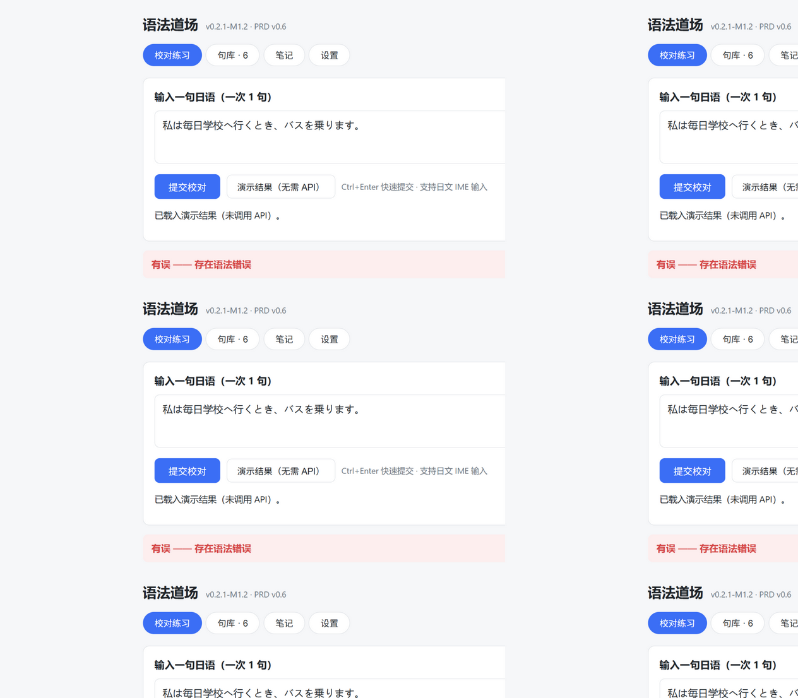
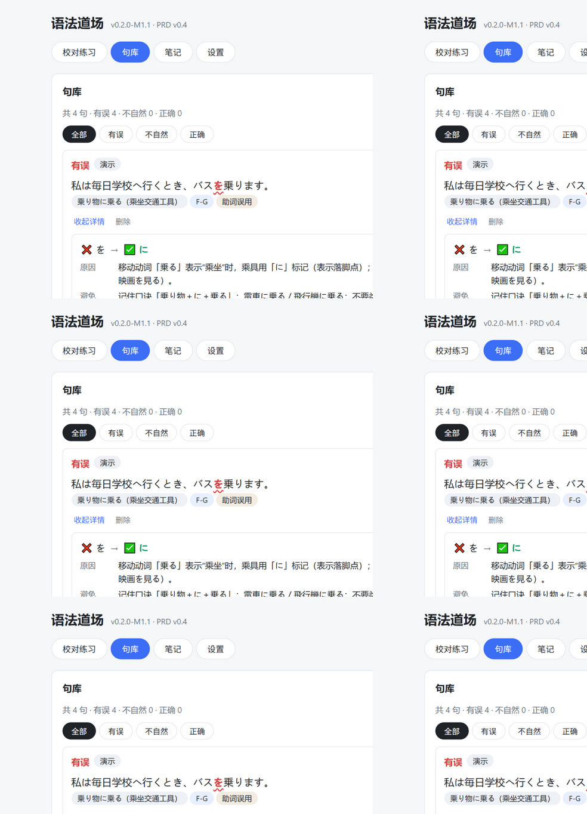
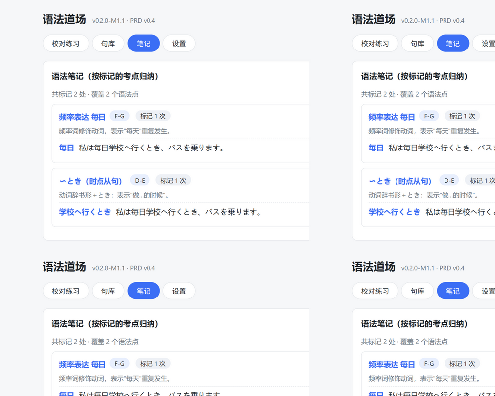
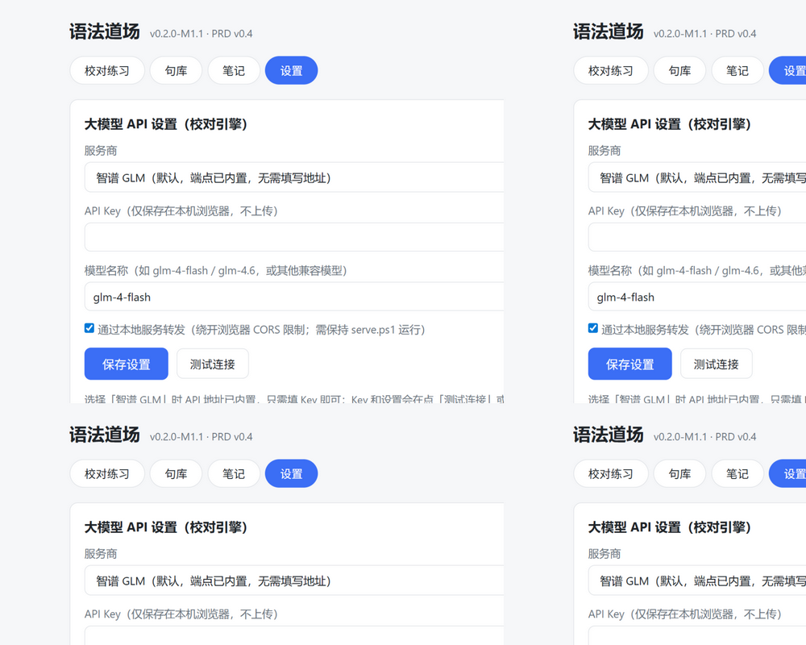
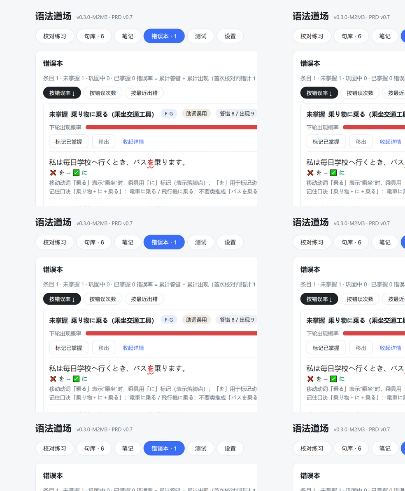
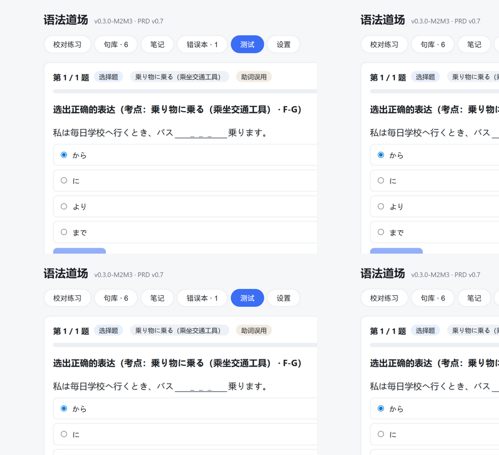
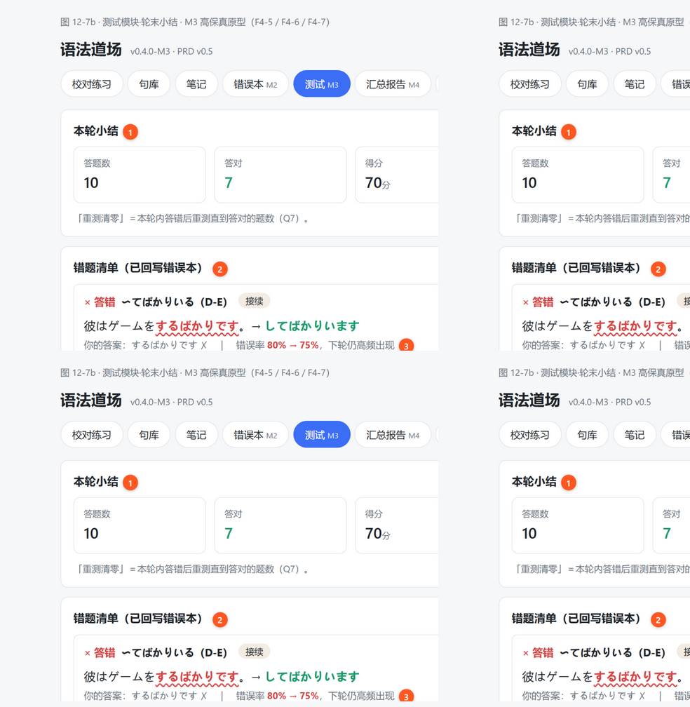
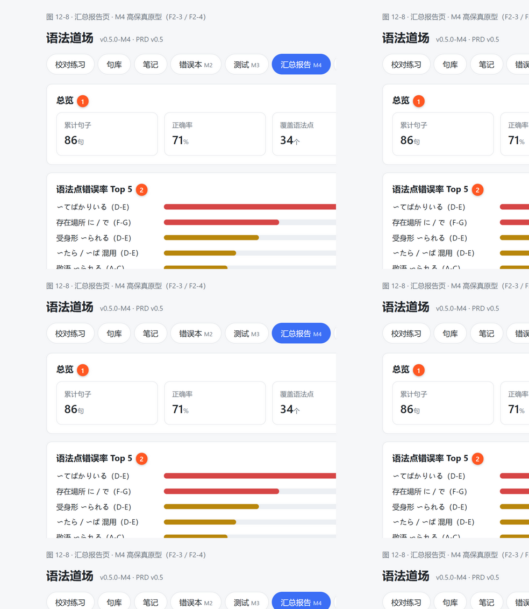

# PRD：日语语法智能学习工具

## 0. 文档信息与版本记录

| 项目 | 内容 |
|---|---|
| 产品名称 | 日语语法智能学习工具（暂定名：语法道场） |
| 当前版本 | **v1.0** |
| 文档状态 | ✅ M1~M3＋M1.3~M1.5 已交付 · 接续复核两段流水线上线 · 待开发 M4（汇总报告＋导出） |
| 产品形态 | 单用户在线工具（本地 Web 应用） |
| 目标用户 | 日语学习者本人（备考 J.TEST / 日常语法巩固） |

### 0.1 版本记录

> 制度约定：**每一轮 review 都必须在下表追加一行**，写明版本号、日期、变更说明与状态；旧版本文件归档不删除。

| 版本 | 日期 | 修订 | 变更说明 | 状态 |
|---|---|---|---|---|
| v0.1 | 2026-10-24 | ZCode | 初稿：确立「写句→校对→错误本→加权测试」学习闭环与 F1–F4 四模块框架；提出 Q1–Q7 待确认项 | 已归档 |
| v0.1.1 | 2026-10-24 | ZCode | 交付交互式可视化 PRD 页（五页签）；修复页签依赖宿主运行时导致的点击失效（改为自带幂等实现） | 已归档 |
| v0.2 | 2026-10-24 | ZCode | 对照标准 PRD 重构：新增「版本记录／用户与场景／需求范围／统计口径／风险与应对／附录」分区；需求编号并标注 P0–P2；新增用户故事与验收标准；固化统计口径公式；可视化页改版 | 已归档 |
| v0.3 | 2026-10-24 | ZCode | R2 确认落档：Q1–Q7 全部确认，开放问题清零，PRD 冻结。需求调整：原 F4-8 拆分（填空 F4-9 P0／翻译 F4-10 P2）；分级体系定为 J.TEST 级别；F2-4 格式冻结 Markdown＋CSV 并提升 P1；技术方案冻结（LLM API）。M1 开发启动 | 已归档 |
| v0.3.1 | 2026-10-24 | ZCode | M1 交付后联调修复（应用侧，不改变需求）：serve.ps1 新增本地 API 转发端点解决浏览器 CORS（Failed to fetch）；设置页新增「本地转发」开关；新增「服务商预设」（智谱 GLM 端点内置）与自定义端点校验（须以 /chat/completions 结尾，修复误贴网页地址导致的 405）；设置在测试/保存时自动持久化 | 已交付 |
| v0.4 | 2026-10-24 | ZCode | **R3 实测反馈新增需求「考点识别＋语法笔记」**：新增 F1-5（校对时同步识别句中考点语法，含正确句）与 F5 语法笔记模块（F5-1 点击标记、F5-2 按语法点归纳、F5-3 笔记详情）；数据模型 Sentence 新增 grammar_points[]；里程碑新增 M1.1 增量交付 | 已交付 |
| v0.5 | 2026-10-24 | ZCode | **R4 要求参考墨刀（Modao）式 PRD 补全页面渲染图**：新增 §12「页面设计与交互」——① 图 12-1 信息架构与页面流程图；② 图 12-2~12-5 已上线四页（校对练习／句库／笔记／设置）**真实界面渲染图**＋交互说明表；③ 图 12-6~12-8 未上线里程碑（错误本 M2／测试 M3／汇总报告 M4）**高保真原型渲染图**（含编号交互标注①~⑤）；原型源文件 `app/_mockups/`，图片资产 `PRD-assets/`（9 张） | 已交付 |
| v0.6 | 2026-10-24 | ZCode | **R5 实测反馈新增需求「下一句快捷继续＋保存安心动画」**：新增 F1-6（批改结果下方「下一句」按钮，点击后归档动画「✓ 已存入句库」上滑淡出 → 输入框清空并自动聚焦，直接进入下一句）；句库页签新增实时计数徽标；里程碑新增 M1.2（练习连击流）；尊重系统「减弱动态效果」偏好 | 已交付 |
| v0.7 | 2026-10-24 | ZCode | **R6 要求启动 M2＋M3 开发，已全部交付并通过冒烟测试（应用 v0.3.0-M2M3）**：① M2 错误本（F3-1~F3-4：判错自动收录、统计口径 §1.4 落地、掌握状态三档自动流转、手动标记/移出、三种排序、下轮出现概率条）＋句库搜索与语法点筛选（F2-2）；② M3 测试模块（F4-1~F4-9：加权出题（错误本≥80%＋正确句防遗忘、同条目/语法点每轮≤2题）、三题型（改错点击分段＋改正／选择挖空四选一、干扰项取同类易混（自身错误史＋类型词库）／填空多答案判对）、即时判分＋解析、轮内答错重测直到答对、结果回写错误率、轮末小结与错题清单）；③ Prompt 扩展 accepted 多可接受答案；④ §12.6/12.7 渲染图替换为真实界面截图（原型图归档于 PRD-assets）；⑤ 修复两处缺陷：选择题标题泄题、重测题深拷贝导致回写丢失 | 已交付 |
| v0.8 | 2026-10-24 | ZCode | **R7 实测反馈「考点细分＋相似语法辨析」，M1.3 已交付（应用 v0.4.0）**：① F1-5 升级——考点识别细分到 J.TEST 具体语法条目（如「〜以後＝…以后」「〜あまり＝过于」），grammar_points 新增 meaning（中文释义）与 related（易混条目 0~3 个），Prompt 以用户实例锚定粒度；② 新增 F5-4 相似语法归纳与辨析——笔记页按共同核心（汉字≥1／假名≥2）对已标记语法点自动聚类（如「上」系列），一键「AI 辨析」调用大模型生成逐条对比表（意思／接续／核心区别／例句），支持自定义输入 2~4 条目对比，结果缓存本机；③ 校对/错误本的 grammar_point 同步要求条目级粒度 | 已交付 |
| v0.9 | 2026-10-24 | ZCode | **R8 漏判反馈「〜以来 接续」（用户判断正确：動詞て形/名詞＋以来，「辞めた以来」应为「辞めて以来」），防复发三件套已交付（应用 v0.4.1，M1.4）**：① Prompt 增加「接续核对清单」——逐条目核对活用形接续（て形/た形/辞書形/ない形/名詞/助詞），不一致即判 wrong，列高频误用类别（た形与て形混接等），要求输出前自检，不得凭语感下结论；② 新增 F1-7「重新批改」按钮（同句复查，保留标记状态，复核后判错自动补录错误本，防重复计数以 _ingestedKeys 去重）；③ 新增 F1-8「反馈漏判/误判」按钮（类型＋说明存档，句库与结果页徽标展示，作为 Prompt 迭代数据）——兑现风险 R-1 的人工纠偏缓解措施；④ 设置页增加模型升级建议（glm-4.6） | 已归档 |
| v1.0 | 2026-10-24 | ZCode | **R9 用户复测仍漏判（R8 的 Prompt 方案失败），M1.5 接续复核两段流水线已交付（应用 v0.4.2）**。根因复盘：① 超长 Prompt 指令堆积导致轻量模型（glm-4-flash）遵循能力退化；② v0.9 修复未经真实 API 端到端验证即交付（违反冒烟测试准则）。架构级修复——新增 **F1-9 接续复核流水线**：第一层**本地确定性硬规则**（教科书级接续误用，零 API 依赖、保证命中、自动生成修正，当前收录 [た/だ]＋以来）；第二层**软规则疑似片段 → 单目的专项校验调用**（少样本小 Prompt：たびに/次第/がたい/つつ/きる/がち/の以来，宁漏勿误）；复核失败降级为页面警示。验证：7 项确定性扫描测试全过（原句命中＋4 类不误报＋软规则正反例），UI 链路无回归 | **当前版本** |

### 0.2 评审记录

| 轮次 | 日期 | 评审方 | 评审意见 | 处理结果 |
|---|---|---|---|---|
| R1 | 2026-10-24 | 用户 | ① 要求可视化 PRD；② 反馈页签无法点击；③ 要求优化分区／模块搭配／内容突出／可视化／标记；④ 建立版本说明制度 | ① 已交付可视化页；② 已修复并输出对抗性分析；③④ 均在 v0.2 落实 |
| R2 | 2026-10-24 | 用户 | 确认 Q1–Q7 全部问题（大模型 API／J.TEST 级别／改错＋选择＋填空／Markdown＋CSV／电脑为主兼容手机／一次 1 句／直到答对） | 已全部落档 v0.3；PRD 冻结，M1 开发 |
| R3 | 2026-10-24 | 用户 | API 已打通；实测提出新需求：识别句中考点语法，鼠标点击做标记，笔记按标记的语法归纳 | v0.4 立项：F1-5＋F5 模块＋M1.1 增量交付，已实现并通过冒烟测试 |
| R4 | 2026-10-24 | 用户 | PRD 进一步优化：参考墨刀做出来的效果，必要的地方追加渲染图 | v0.5 新增 §12 页面设计与交互：信息架构图＋已上线页真实截图＋未上线页高保真原型图（含编号交互标注） |
| R5 | 2026-10-24 | 用户 | 校对后缺少进入下一句的入口，只能手动删旧句再输入；希望在批改结果模块下方有一个按键直接进入下一次校对，且点击后有「结果已保存」的动画反馈带来安心感 | v0.6 新增 F1-6（下一句按钮＋归档动画＋自动聚焦），M1.2 已实现并通过冒烟测试 |
| R6 | 2026-10-24 | 用户 | 开始 M2 和 M3 的开发 | v0.7 交付 M2（错误本＋统计＋句库搜索）与 M3（测试模块完整闭环），全流程冒烟测试通过（含权重出题、回写持久化、轮内重测） |
| R7 | 2026-10-24 | 用户 | 考点识别不够精确：例「仕事を辞めた以後…」应标记「以後＝…以后」、「気持ちのあまり」应标记「あまり＝过于」（J.TEST 考点级别粒度）；并希望相似语法（如上で/上の/上は）能整理归纳对比，方便记忆 | v0.8 / M1.3：F1-5 升级为条目级识别＋中文释义＋易混项；新增 F5-4 相似语法自动聚类＋AI 辨析对比表（已冒烟测试；AI 辨析需 API Key，待用户实测） |
| R8 | 2026-10-24 | 用户 | 「仕事を辞めた以来、毎日履歴書を書いています。」漏判：「〜以来」应接動詞て形/名詞（辞めた以来→辞めて以来）。要求先核实判断，再做对抗性分析并防复发 | 判断核实为正确（JLPT N2/J.TEST 考点，教学资料一致）；v0.9 / M1.4：Prompt 接续核对清单＋F1-7 重新批改＋F1-8 反馈漏判/误判（兑现 R-1 缓解），对抗性分析已输出 |
| R9 | 2026-10-24 | 用户 | 复测后依然漏判同一句子，情况严重，要求立刻彻底解决 | v1.0 / M1.5：承认 v0.9 方案失败（长 Prompt 退化＋未经真实 API 验证即交付），架构级修复：本地确定性硬规则（保证命中「た/だ＋以来」类）＋专项校验两段流水线（F1-9），7 项确定性测试全过；端到端真实 API 复测由用户执行（其 Key 在另一浏览器实例，无法代跑） |
| — | 2026-10-24 | 用户 | 联调反馈：Failed to fetch（CORS）；HTTP 405（误贴网页地址） | v0.3.1 修复（本地转发／服务商预设／端点校验／自动保存） |

---

## 1. 产品概述

### 1.1 一句话定位
面向日语学习者的个人语法学习闭环工具——**写句即批改，错误必沉淀，考点可标记，复习有重点**。

### 1.2 背景与痛点

| # | 痛点 | 具体表现 | 对应解法 |
|---|---|---|---|
| P-1 | 没人批改 | 写完句子不知道对不对、错在哪、为什么错 | F1 AI 校对：错误高亮＋正确写法＋原因＋避免建议 |
| P-2 | 错误重复犯 | 错了没有记录，同样的坑反复踩 | F3 错误本：每错必记，错误率全程统计 |
| P-3 | 复习无重点 | 不知道该优先练什么，复习凭感觉 | F4 加权测试：错误率越高出题越频繁 |
| P-4 | 考点无沉淀 | 句子里用到的好语法点（尤其正确的）没人指出、记不下来 | F1-5＋F5：考点自动识别，点击标记进笔记，按语法点归纳 |

### 1.3 产品目标（可衡量）

| 目标 | 度量方式 |
|---|---|
| 每句必获专业批改 | 校对模块对每次提交都返回结构化结果（覆盖率 100%） |
| 每句必获考点识别 | 每次校对返回句中考点语法列表（覆盖率 100%） |
| 薄弱点可定位 | 汇总报告可列出错误率 Top 语法点／错误类型 |
| 高频错误被消灭 | 错误本中错误率 ≥50% 的条目，两周内错误率降至 <20% |
| 考点资产可积累 | 笔记按语法点归组，标记总数与覆盖语法点数可见 |

### 1.4 术语与统计口径（全局唯一定义，所有模块引用此处）

| 术语 | 定义 |
|---|---|
| **出现次数** | 一条错误的累计出现次数 ＝ 1（首次校对判错）＋ 测试中作为题目出现的次数 |
| **答错次数** | ＝ 1（首次校对判错）＋ 测试中答错的次数 |
| **错误率** | 答错次数 ÷ 出现次数（四舍五入到百分点显示，计算保留原值） |
| **测试次数** | 出现次数 − 1（即不含首次校对） |
| **掌握状态** | 🔴 未掌握：错误率 ≥ 50%；🟡 巩固中：20% ≤ 错误率 < 50%；🟢 已掌握：错误率 < 20% **且** 测试次数 ≥ 3 |
| **出题权重 W** | W = max(错误率, 2%) × (1 + 0.15 × min(距上次出现轮数, 6)) × 掌握系数；掌握系数：已掌握 = 0.3，其他 = 1 |
| **考点语法（grammar point hit）** | 校对时由 AI 识别的、句中实际出现的考点语法：片段（原句连续子串）＋语法点名＋J.TEST 级别＋一句话说明；正确句同样识别 |
| **标记（mark）** | 用户点击考点语法条目产生的收藏动作；同一语法点跨句子标记自动归组；可随时取消 |

---

## 2. 用户与场景

### 2.1 用户画像
- 单用户（开发者本人使用），日语中级水平，备考 J.TEST；
- 日常用电脑学习，已确认自备大模型 API Key（Q1，已打通）；
- 无需注册登录、多端同步等企业级能力。

### 2.2 典型场景

| 场景 | 触发 | 用户动作 | 系统响应 | 结束状态 |
|---|---|---|---|---|
| S1 造句练习 | 学完一个语法点 | 输入一句日语并提交 | 三档判定＋错误四要素＋**考点语法列表**；判错自动入错误本 | 知道对错与原因，看到句中考点 |
| S1b 考点标记 | 批改结果中看到值得记的语法 | **点击考点条目** | 条目标记成功（可再点取消），写入笔记 | 考点进入语法笔记 |
| S2 定期复盘 | 每周一次 | 打开汇总报告／语法笔记 | 错误率排行＋**笔记按语法点归组（例句齐全）** | 找到下周重点 |
| S3 每日测试 | 每天 10 分钟 | 开始一轮 10 题测试 | 按权重出题，逐题判分解析，轮末小结并回写统计 | 薄弱错误被高频复习 |

---

## 3. 需求范围

### 3.1 一期纳入（P0 + P1，对应 M1–M4 及增量 M1.1）
校对、句库、错误本、测试四大模块的全部 P0/P1 需求，以及 M1.1 考点识别＋语法笔记。

### 3.2 明确不做（Out of Scope）
- 多用户／账号体系／云端同步（单用户本地工具）；
- 社交、排行榜、打卡分享；
- 发音、听力、词汇背诵（本产品聚焦**语法**）；
- 离线 NLP 引擎（校对依赖大模型 API，Q1 已确认）。

### 3.3 依赖与假设（R2 确认后固化）
- **硬依赖**：大模型 API（OpenAI 兼容接口，用户自备 Key，默认 GLM，可配置任意兼容端点）；
- 设备：电脑为主、响应式兼容手机（Q5 已确认）；
- 语法点分级体系：按 J.TEST 级别（A-C／D-E／F-G）初始化，后续可增补（Q2 已确认）。

---

## 4. 功能需求（F1–F5）

> 优先级定义：**P0** = MVP 必须，缺失则闭环断裂；**P1** = 重要，显著提升可用性；**P2** = 后续版本可选。**各页面渲染图与编号交互标注见 §12。**

### F1 句子校对（核心入口）

**用户故事**：作为学习者，我要提交一句日语后立刻知道对错、错在哪、为什么错、如何避免、**句里用了哪些考点语法**，以便不带着错误印象继续练习、并沉淀好语法。

| 编号 | 需求 | 优先级 | 里程碑 | 验收标准 |
|---|---|---|---|---|
| F1-1 | 三档判定（正确／不自然／有误） | P0 | M1 | 任意提交 10 秒内返回三档之一；正确句不误判为"有误"（抽检误判率 <5%） |
| F1-2 | 错误四要素高亮标注 | P0 | M1 | 原句高亮每处错误片段，逐处给出：位置／正确写法／错误原因／避免建议；多处错误逐一标注 |
| F1-3 | 语法点＋错误类型标签 | P0 | M1 | 每处错误带 ≥1 个语法点标签（分级按 J.TEST，见附录 11.2）和 1 个错误类型标签（附录 11.1） |
| F1-4 | 整句中文翻译 | P1 | M2 | 每次校对返回整句中文译文 |
| F1-5 | **考点语法识别（v0.4 新增，v0.8 升级为条目级粒度）** | P0 | M1.1/M1.3 | 每次校对（含完全正确的句子）返回句中考点语法列表，每条含：原句片段（连续子串）、**具体语法条目名（J.TEST 考纲条目，如「〜以後」「〜あまり（の）」，禁止宽泛类别）**、**中文释义（meaning，如「…以后」「过于」）**、J.TEST 级别、用法说明、**易混相关条目（related，0~3 个）**；按考试重要性最多 6 条 |
| F1-6 | **下一句快捷继续＋保存安心动画（v0.6 新增）** | P1 | M1.2 | 批改结果模块正下方常驻「下一句 ▸」按钮；点击后当前结果播放归档动画（绿色确认层「✓ 已存入句库」＋整块上滑淡出，约 0.56 秒），随后输入框清空并自动聚焦（可直接用 IME 输入下一句）；句库页签显示实时计数；动画尊重系统「减弱动态效果」设置（动画时长降为瞬时，功能不变） |
| F1-7 | **重新批改（v0.9 新增，R-1 缓解）** | P1 | M1.4 | 批改结果卡片提供「重新批改」按钮：对同句再次调用校对（Prompt 已含接续核对清单）；保留已标记考点的标记状态；复核后判错的条目自动补录错误本（同句同语法点不重复计数）；显示复核次数徽标 |
| F1-8 | **反馈漏判/误判（v0.9 新增，R-1 缓解）** | P1 | M1.4 | 批改结果卡片提供「反馈漏判/误判」按钮：选择类型（漏判/误判）＋补充说明，存入句子档案；结果页与句库显示「已反馈·类型」徽标；反馈数据作为 Prompt 持续迭代的依据 |
| F1-9 | **接续复核两段流水线（v1.0 新增）** | P0 | M1.5 | ① 硬规则层：教科书级接续误用（当前 [た/だ]＋以来）在本地以正则确定性检测，**不依赖模型**：命中即强制判「有误」并自动生成修正（同词干形态交换）与整句修正，并入错误本；② 软规则层：高频误用模式（たびに/次第/がたい/つつ/きる/がち/の以来）仅标记疑似片段，交单目的少样本校验调用判定（宁漏勿误），判错则并入 corrections；③ 校验调用失败降级为结果页警示（可重新批改）；④ 规则可持续扩充（每条规则含规范接续说明与修正策略）；⑤ 不得对正确接续（て以来/卒業以来/片假名词尾）误报 |

**详细说明**：
- 判定三档：✅ 正确／ ⚠️ 不自然／ ❌ 有误（自动进错误本）；判定口径以 J.TEST 考纲为准，口语化但正确判"不自然"；
- 示例：原句「私は毎日学校へ行くとき、バス**を**乗ります。」→ 错误「を」→「に」（助词误用，F-G）；考点语法：「毎日（频率表达，F-G）」「〜とき（时点从句，D-E）」「乗り物に乗る（F-G）」。

### F2 句库与汇总

**用户故事**：作为学习者，我要所有练过的句子自动归档并可按语法点归纳汇总，以便回看历史、定位薄弱点。

| 编号 | 需求 | 优先级 | 里程碑 | 验收标准 |
|---|---|---|---|---|
| F2-1 | 提交自动存档 | P0 | M1 | 提交后句库即时可见新记录（原文／判定／时间／批改详情／考点列表）；刷新、重开不丢失 |
| F2-2 | 筛选与搜索 | P1 | M2 | 可按判定结果、语法点筛选，支持关键词搜索，结果正确 |
| F2-3 | 汇总报告 | P1 | M4 | 展示总览、语法点错误率排行、错误类型占比、正确率趋势 |
| F2-4 | 报告导出（Markdown＋CSV，Q4 已确认） | P1 | M4 | 一键导出 Markdown 与 CSV 两种文件，内容与页面一致 |

### F3 错误本

**用户故事**：作为学习者，我要每个错误被自动记录并统计错误率，以便看到自己的惯性错误和掌握进度。

| 编号 | 需求 | 优先级 | 里程碑 | 验收标准 |
|---|---|---|---|---|
| F3-1 | 自动收录 | P0 | M2 | 判"有误"的提交自动进入错误本，无需手动操作；同一语法点重复出错累计计数 |
| F3-2 | 统计字段 | P0 | M2 | 展示错误次数、测试次数、答错次数、错误率，数值与 1.4 口径完全一致 |
| F3-3 | 掌握状态三档 | P0 | M2 | 状态按 1.4 阈值自动流转，变更即时反映到列表与测试出题权重 |
| F3-4 | 手动操作与排序 | P1 | M2 | 手动"标记已掌握"／"移出"即时生效；支持按错误率、错误次数、最近出错时间排序 |

### F4 测试模块

**用户故事**：作为学习者，我要系统根据我的错误率智能出题——错得越多考得越勤，以便用最少时间消灭高频错误。

| 编号 | 需求 | 优先级 | 里程碑 | 验收标准 |
|---|---|---|---|---|
| F4-1 | 题源策略 | P0 | M3 | 每轮题目全部来自用户历史句子；错误本条目占比 ≥80%，正确句低频掺入防遗忘 |
| F4-2 | 加权出题算法 | P0 | M3 | 出现频率随错误率单调递增；同一语法点每轮 ≤2 题；已掌握条目降权但不清零；口径同 1.4 |
| F4-3 | 题型 A 改错题 | P0 | M3 | 展示当初错误原句，可点击选中错误片段并改正，系统判分 |
| F4-4 | 题型 B 选择题 | P0 | M3 | 错误点挖空四选一，干扰项为同类易混表达，答后展示解析 |
| F4-5 | 测试流程与小结 | P0 | M3 | 可选每轮题数（默认 10）→ 逐题即时判分＋解析 → 轮末小结（得分＋错题清单） |
| F4-6 | 结果回写 | P0 | M3 | 答错 → 错误次数+1、错误率↑；答对 → 错误率↓；达阈值自动转"已掌握" |
| F4-7 | 轮内答错重测（Q7 已确认：直到答对） | P1 | M3 | 轮内答错的题稍后重复出现，直到答对为止 |
| F4-9 | 题型 C 填空题（Q3 已确认纳入一期） | P0 | M3 | 原句错误点挖空，用户键入正确表达；支持多个可接受答案判对；判分后展示解析 |
| F4-10 | 翻译题（Q3 未选，顺延） | P2 | 后续 | 如后续需要再排期 |

### F5 语法笔记（v0.4 新增）

**用户故事**：作为学习者，我要把批改结果里值得记住的考点语法点一下就收进笔记，并按语法点归纳查看，以便系统积累自己的语法资产。

| 编号 | 需求 | 优先级 | 里程碑 | 验收标准 |
|---|---|---|---|---|
| F5-1 | 点击标记 | P0 | M1.1 | 批改结果与句库详情中的考点语法条目可点击标记／取消；标记状态持久保存，刷新不丢；界面即时反馈（已标记态可见） |
| F5-2 | 按语法点归纳 | P0 | M1.1 | 笔记页按语法点归组：组头显示语法点名、级别、标记次数；组内列出全部标记例句（片段＋整句＋时间）；按标记次数降序 |
| F5-3 | 笔记详情 | P1 | M1.1 | 组内显示该语法点的说明与释义；每条例句可取消标记；笔记页顶部显示总标记数与覆盖语法点数 |
| F5-4 | **相似语法归纳与辨析（v0.8 新增）** | P1 | M1.3 | ① 自动聚类：对已标记语法点按共同核心（共享汉字≥1 或假名≥2）归纳成"系列"（如「上」系列：〜上で／〜上の／〜上は）；② AI 辨析：点击系列卡片或自定义输入 2~4 个条目，调用大模型生成逐条对比表（条目／意思／接续／核心区别／例句）；③ 结果缓存本机（localStorage），重复查看零成本；④ 未配置 Key 时给出明确引导 |

---

## 5. 非功能需求

| 编号 | 需求 | 优先级 | 状态 |
|---|---|---|---|
| N-1 | 校对响应 ≤ 10 秒（依赖 API 网络） | P0 | — |
| N-2 | 数据本地持久化，一键导出／导入 JSON 备份 | P0 | — |
| N-3 | 支持日文 IME 输入，一次提交 1 句（Q6 已确认） | P0 | 已确认 |
| N-4 | 界面自适应宽度，电脑为主、兼容手机浏览器（Q5 已确认） | P1 | 已确认 |
| N-5 | 界面中文、例句日文 | P0 | — |

---

## 6. 数据模型与算法

### 6.1 数据结构

```
Sentence 句子表
  id, 原文, 提交时间, 判定结果(正确/不自然/错误),
  批改明细[], 考点语法[], 译文

Correction 批改明细（嵌于句子）
  错误片段, 起止位置, 正确写法, 修正后整句, 错误原因, 避免建议,
  语法点标签, J.TEST级别, 错误类型标签

GrammarPointHit 考点语法（嵌于句子，v0.4 新增，v0.8 扩展）
  segment(原句连续子串), point(J.TEST 具体语法条目名，如 〜以後),
  meaning(中文释义，如 "…以后"), level(A-C/D-E/F-G),
  note(用法说明), related(易混条目名数组，0~3 个),
  marked(是否已标记进笔记, 默认 false)

CompareCache 辨析缓存（v0.8 新增）
  key(条目名排序后拼接) → { at(生成时间), rows[{point, meaning, conn, diff, example}] }

ErrorItem 错误本条目
  id, 关联句子id, 批改明细, 错误次数, 测试次数, 答错次数,
  最近出现时间, 掌握状态(未掌握/巩固中/已掌握)

TestRecord 测试记录
  id, 测试时间, 题目[], 答题结果[], 本轮得分
```

### 6.2 出题权重算法（口径见 1.4）

```
每轮出题（默认 10 题，题型从改错／选择／填空中随机指派）：
1. 计算每条错误本条目权重 W（见 1.4 公式），正确句池取低固定权重
2. 按 W 加权不放回抽样，同一条目每轮最多抽中 2 次
3. 同一语法点每轮 ≤ 2 题
4. 答题后即时回写：答对/答错 → 更新错误率 → 影响下一轮权重
5. 轮内答错的题目进入本轮"重测队列"，稍后再次出现直到答对（Q7）
```

### 6.3 备份兼容（v0.4）

- 旧备份 JSON（无 grammar_points 字段）导入后按空考点列表处理，不影响其他字段；
- 导出格式包含 grammar_points，向前兼容。

---

## 7. 技术方案（✅ Q1 确认后冻结）

| 项 | 方案 | 说明 |
|---|---|---|
| 产品形态 | 本地 Web 应用，浏览器访问（serve.ps1 本地服务） | 单用户，无需部署与注册登录 |
| 前端 | 纯 HTML/CSS/JS 单文件应用（无构建依赖） | 界面中文、例句日文 |
| 校对引擎 | 大模型 API（OpenAI 兼容 Chat Completions，结构化 JSON 批改） | 默认 GLM 端点（内置预设），可配置任意兼容端点；Key 自备；本地转发解决 CORS |
| 数据存储 | 浏览器 localStorage＋JSON 导出／导入备份 | 防清缓存丢数据 |
| 出题算法 | 前端确定性算法 | 可解释、零成本，不依赖 AI |

---

## 8. 里程碑与发布计划

| 里程碑 | 内容 | 覆盖需求 | 验收口径（完成标准） | 状态 |
|---|---|---|---|---|
| M1 | 校对＋句库 | F1-1~F1-3、F2-1、N-2 | 可造句、可批改、可回看历史且刷新不丢；API 可配置＋演示模式 | ✅ 已交付（含 v0.3.1 联调修复） |
| **M1.1** | **考点识别＋语法笔记（v0.4）** | **F1-5、F5-1~F5-3** | **批改返回考点列表；点击可标记；笔记按语法点归组；刷新不丢** | **✅ 已交付** |
| **M1.2** | **下一句快捷继续＋保存动画（v0.6）** | **F1-6** | **批改后按钮可见；点击播放归档动画后输入框自动聚焦；句库计数实时更新** | **✅ 已交付** |
| **M1.3** | **考点细分＋相似语法辨析（v0.8）** | **F1-5 升级、F5-4** | **考点识别到条目级（含释义与易混项）；笔记页自动聚类＋AI 辨析对比表（缓存）** | **✅ 已交付（AI 辨析待用户带 Key 实测）** |
| **M1.4** | **接续核对＋重新批改＋反馈闭环（v0.9）** | **F1-7、F1-8、Prompt 强化** | **Prompt 含接续核对清单与高频误用类别；「重新批改」「反馈漏判/误判」可用并显示徽标** | **✅ 已交付（Prompt 强化被 R9 证明不足，由 M1.5 架构修复替代）** |
| **M1.5** | **接续复核两段流水线（v1.0）** | **F1-9** | **硬规则确定性命中且不误报（7 项测试）；软规则专项校验可用；复核失败有降级警示** | **✅ 已交付** |
| M2 | 错误本＋统计 | F1-4、F2-2、F3-1~F3-4 | 错误自动归档，错误率与状态按口径流转 | ✅ 已交付（v0.7） |
| M3 | 测试模块 | F4-1~F4-9 | 加权出题＋三题型＋结果回写，闭环完整跑通 | ✅ 已交付（v0.7） |
| M4 | 汇总报告＋导出 | F2-3、F2-4 | 报告四板块齐全，Markdown＋CSV 导出可用 | 待开始 |

---

## 9. 风险与应对

| # | 风险 | 影响 | 概率 | 应对 |
|---|---|---|---|---|
| R-1 | LLM 批改误判／漏判 | 学习者被误导 | 中 | ✅ 已上线（v0.9）：「反馈漏判/误判」按钮（F1-8）＋「重新批改」按钮（F1-7）＋ Prompt 接续核对清单；后续：批改结果可编辑、关键语法抽检、反馈数据驱动的 Prompt 迭代 |
| R-2 | API 不可用／费用超预期 | 校对中断 | 中 | 批改结果缓存避免重复计费；断网降级「暂存待批」；用量估算展示 |
| R-3 | 浏览器清缓存导致数据丢失 | 学习资产损失 | 中 | 本地存储＋自动备份提醒＋一键导出／导入 |
| R-4 | 使用频率衰减，闭环失效 | 产品价值归零 | 中 | 单句 30 秒完成整个闭环；连续天数与掌握进度可视化激励 |
| R-5 | 考点识别过多／不准（v0.4） | 笔记噪音大 | 中 | 限制最多 6 条并按考试重要性排序；标记权在用户，未标记不进笔记 |

---

## 10. 决策存档（✅ R2 全部确认，本章仅作存档）

| # | 问题 | 确认结果 | 备注 |
|---|---|---|---|
| Q1 | 校对引擎 | **大模型 API** | 已打通（GLM＋本地转发） |
| Q2 | 语法点标签体系 | **J.TEST 级别（A-C／D-E／F-G）** | 考点语法 level 同此体系 |
| Q3 | 一期题型 | **改错题＋选择题＋填空题** | 填空题 P0（F4-9）；翻译题顺延 P2（F4-10） |
| Q4 | 汇总导出格式 | **Markdown＋CSV** | F2-4 提升 P1，格式冻结 |
| Q5 | 使用设备 | **电脑为主，响应式兼容手机** | N-4 确认 |
| Q6 | 单次批改量 | **一次 1 句** | N-3 确认 |
| Q7 | 答错轮内重测 | **重复直到答对** | F4-7 确认 |

---

## 11. 附录

### 11.1 错误类型枚举（一期）
助词误用 ／ 动词变形 ／ 时态・体 ／ 敬语 ／ 接续 ／ 惯用搭配 ／ 语序 ／ 其他

### 11.2 语法点标签体系（依 Q2：J.TEST 级别）
- 级别取值：**A-C**（中上级）／ **D-E**（初中级）／ **F-G**（入门级）；
- 与 JLPT 的大致换算（供迁移参考）：N5≈F-G、N4≈F-G~D-E、N3≈D-E、N2≈D-E~A-C、N1≈A-C；
- 标签结构：`级别 + 语法点名称`（如「D-E：〜ばかり」）；考点语法（F1-5）同此体系；支持后续增补自定义语法点。

### 11.3 错误四要素与考点识别示例
见 F1 详细说明；可视化 PRD 页「功能需求」页签内有完整交互示例。

---

## 12. 页面设计与交互（渲染图）

> 本章为 v0.5 新增（R4）。制图规范参考墨刀（Modao）式 PRD：**信息架构图 → 页面渲染图 → 编号交互标注**。已上线页面为真实界面截图；未上线里程碑页面为高保真原型（视觉规格与现有应用一致，图中橙红圆点①~⑤为交互标注，与图下方说明表对应）。图片资产位于 `PRD-assets/`，原型源文件位于 `app/_mockups/`（本地服务运行时可访问预览）。

### 12.1 信息架构与页面流程（图 12-1）



### 12.2 校对练习页（已上线 · 真实界面 · 图 12-2）



| 标注 | 交互说明 | 需求 |
|---|---|---|
| ① 输入区 | 一次 1 句（≤300 字符，Q6）；Ctrl+Enter 快速提交；「演示结果」不调 API 体验全流程 | F1 入口 |
| ② 判定横幅 | 三档判定：🟢正确／🟡不自然／❌有误 | F1-1 |
| ③ 错误高亮与四要素 | 原句错误片段红色波浪线高亮；卡片给出 ❌错误→✅正确、原因、避免建议、修正整句 | F1-2 |
| ④ 考点语法条目 | 点击标记／取消（选中态高亮「✓ 已标记」），标记进入笔记 | F5-1 |
| ⑤ 标签与译文 | 语法点·J.TEST 级别·错误类型徽章＋中文译文；结果自动存入句库 | F1-3、F1-4、F2-1 |
| ⑥ 下一句按钮 | 批改结果正下方「下一句 ▸」：点击播放归档动画（绿色「✓ 已存入句库」＋上滑淡出）→ 输入框清空并自动聚焦，无缝进入下一句；句库页签计数实时更新 | F1-6 |

### 12.3 句库页（已上线 · 真实界面 · 图 12-3）



| 标注 | 交互说明 | 需求 |
|---|---|---|
| ① 统计与筛选 | 总数与三档分布统计行；全部／有误／不自然／正确筛选 | F2-1 |
| ② 记录卡片 | 判定徽章＋时间＋原句高亮＋标签；「展开详情」显示四要素、考点语法与译文 | F2-1 |
| ③ 考点标记 | 详情内考点条目同样可点击标记，与批改结果页全局同步 | F5-1 |
| ④ 数据管理 | 导出 JSON 备份／导入（按 id 去重合并）／清空（二次确认） | N-2 |

### 12.4 笔记页（已上线 · 真实界面 · 图 12-4）



| 标注 | 交互说明 | 需求 |
|---|---|---|
| ① 顶部统计 | 总标记数＋覆盖语法点数 | F5-3 |
| ② 按语法点归组 | 组头＝语法点名＋级别徽章＋标记次数；组内＝一句话说明＋例句列表（片段·整句·时间） | F5-2 |
| ③ 排序与联动 | 组按标记次数降序；取消标记即时同步移出（在批改结果/句库再点一次即可） | F5-2/F5-1 |

### 12.5 设置页（已上线 · 真实界面 · 图 12-5）



| 标注 | 交互说明 | 需求 |
|---|---|---|
| ① 服务商预设 | 默认「智谱 GLM」端点内置（地址输入框隐藏，杜绝贴错地址）；可切换「自定义 OpenAI 兼容端点」，强制以 /chat/completions 结尾 | §7 |
| ② Key 与测试 | Key 仅存本机；「测试连接」真实调用验证；设置（含 Key）在测试/保存时自动持久化 | §7、R-3 |
| ③ 本地转发 | 默认开启：请求经 serve.ps1 转发，规避浏览器 CORS（Failed to fetch） | v0.3.1 |

### 12.6 错误本页（M2 · 已上线真实界面 · 图 12-6）



已上线功能（F3-1~F3-4）：判「有误」自动收录（同语法点跨句归并累计）、统计字段与 §1.4 口径一致、掌握状态三档自动流转＋手动标记、三种排序、下轮出现概率条（权重占比）、展开详情（原句高亮＋四要素＋多例句）。设计期原型图归档于 `PRD-assets/fig-errorbook-m2.png`。

### 12.7 测试模块页（M3 · 已上线真实界面 · 图 12-7a/12-7b）





已上线功能（F4-1~F4-9）：加权出题（错误本≥80%＋正确句防遗忘、同条目/同语法点每轮≤2 题）、三题型随机（改错＝点击分段＋改正、选择＝挖空四选一且干扰项取自身同类易混、填空＝多可接受答案判对）、提交即判分＋解析＋错误率变化、答错轮内重测直到答对、轮末小结（得分／重测清零／错题清单／进步提示）。

### 12.8 汇总报告页（M4 高保真原型 · 图 12-8）



图内编号为交互标注，对应需求 F2-3／F2-4：总览四指标、语法点错误率 Top5、错误类型占比、按周正确率趋势、一键导出 Markdown＋CSV（Q4）。
